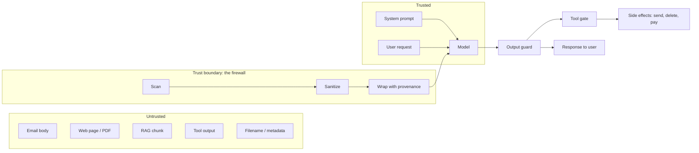

# 2. Threat model

A threat model is a list of what you are protecting, from whom, across which boundary, and
what happens when it fails. This one is written for the four application shapes the kit
supports.

## Assets

| Asset | Why an attacker wants it | Worst case |
|---|---|---|
| Private content in context (mail, files, CRM rows) | resale, espionage, embarrassment | bulk exfiltration through a link or tool call |
| Credentials reachable by tools | full account takeover | token replayed from another machine |
| Tool capabilities (send, delete, pay, execute) | actions with real side effects | irreversible data loss or payment |
| The system prompt and hidden rules | maps the app for a second-stage attack | easier bypass next time |
| User trust | the product's only real asset | silent wrong answers |

## Actors

| Actor | Capability | Realistic goal |
|---|---|---|
| **Content author** | controls text in an email, page, PDF, ticket, comment | make the assistant act for them |
| **Compromised upstream** | controls a document your RAG indexes, or a tool's output | persistent poisoning of many sessions |
| **Malicious insider** | can put content where the assistant will read it | escalate privileges, cover tracks |
| **Curious user** | can type anything | extract the prompt, test the limits |
| **Automated scanner** | mass-submits payloads looking for a hit | find any unpatched app |

The kit is aimed at the first two. The last two are usually handled by policy and rate
limits, not by content filters.

## Trust boundaries

Every arrow crossing from *Untrusted* to *Model* must go through the boundary, and every
arrow from *Model* to a side effect must go through the tool gate. If content can reach the
model without crossing the boundary, the rest of the diagram is decoration.

## What an attacker can gain - by application shape

### Email assistant

* **Can:** read every message the user can read, send mail as the user if a send tool is
  wired without approval, exfiltrate via a markdown image in a reply, poison future turns
  by getting a payload into the thread.
* **Cannot (if built correctly):** act without an approval step, reach other accounts,
  read mail the API did not return.
* **The kit's answer:** `strict` policy, `aggressive` sanitizer, canary in the system
  prompt, `send_email` behind a human approver with a domain allow-list.

### Web-browsing agent

* **Can:** choose which page to fetch next, so a single poisoned page can steer the whole
  session; embed beacons; convince the model that a fake "system notice" is authoritative.
* **Cannot:** break TLS, read cookies the agent does not send, run code unless a code tool
  is exposed.
* **The kit's answer:** per-page scan, hidden-element removal, nonce-delimited wrapping,
  output guard that rejects remote images.

### RAG document reader

* **Can:** poison one chunk and have it retrieved for many users; contradict the real
  policy with a "reference answer"; inflate or deflate numbers.
* **Cannot:** change documents the user opens directly, or persist after the index is
  rebuilt (unless the source is still poisoned).
* **The kit's answer:** scan per chunk, drop only the poisoned chunk, keep provenance, and
  surface conflicts instead of silently choosing.

### Coding agent

* **Can:** put instructions in comments, docstrings, tests, dependency READMEs, commit
  messages and issue text; ask the agent to disable linters, run shell commands or add
  dependencies.
* **Cannot:** escape a container if the container is the boundary.
* **The kit's answer:** deny `run_shell`, require approval for writes, scan repository text,
  and treat "disable the checks" as high severity.

## What the attacker cannot gain (assumptions)

These are assumptions, not guarantees. If one is false, the model changes:

1. **The system prompt is not attacker-writable.** If content can modify it, you have a
   configuration bug, not an injection problem.
2. **Tool calls are authorised by your code, not by the model.** A model that "decides" to
   send mail must still pass a gate.
3. **Secrets are not in the context.** If they are, exfiltration is one good sentence away.
4. **The firewall sees all untrusted content.** A side channel that skips it (a raw
   `print(context)` into a log that another agent reads) is outside this model.
5. **Approvals are made by a human who can see the action.** An approver that returns
   `True` unconditionally is not a control; `harness/simulated_app.py` shows the difference.

## Failure modes this model expects

| Failure | Symptom | Mitigation |
|---|---|---|
| Detector miss | paraphrase, new language, new carrier | wrap + least privilege + output guard, not better regex |
| Detector false positive | legitimate email quarantined | tune policy, keep benign corpus, review quarantines |
| Wrapper bypass | model obeys the block anyway | tool gate; the model is not the last line |
| Tool gate too tight | agent cannot do its job | per-task allow-lists, not one global list |
| Approval fatigue | humans click "yes" | show the diff and the destination, not a toast |
| Canary in logs | alarm fires after the leak | block the response, do not just log |

## Out of scope

* Attacks on the model provider's infrastructure.
* Training-data poisoning.
* Multimodal payloads rendered only as pixels (see `06-limitations-and-honesty.md`).
* Side channels outside the application (a human pasting the model's answer elsewhere).
* Denial of service through very large documents. `wrapper.wrap_untrusted(max_chars=...)`
  bounds the prompt, but that is a cost control, not a security control.
